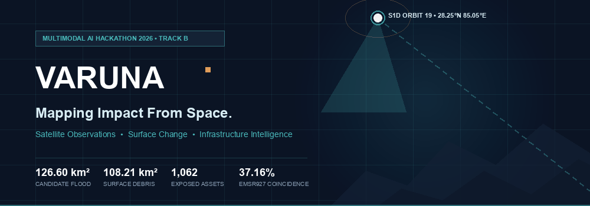
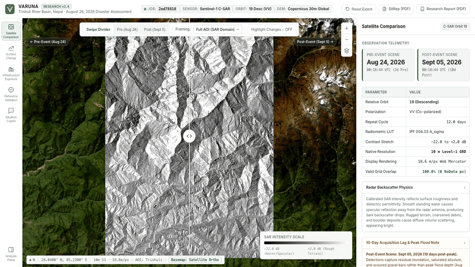
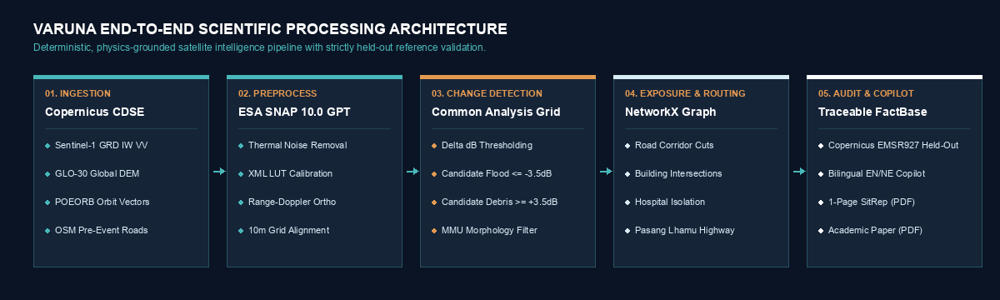
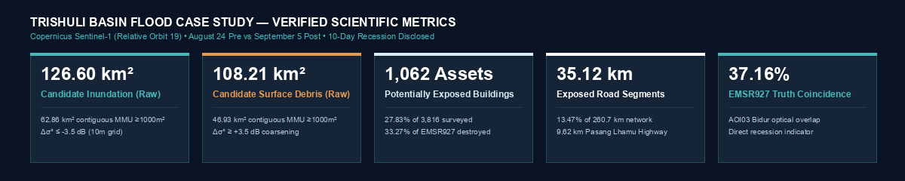
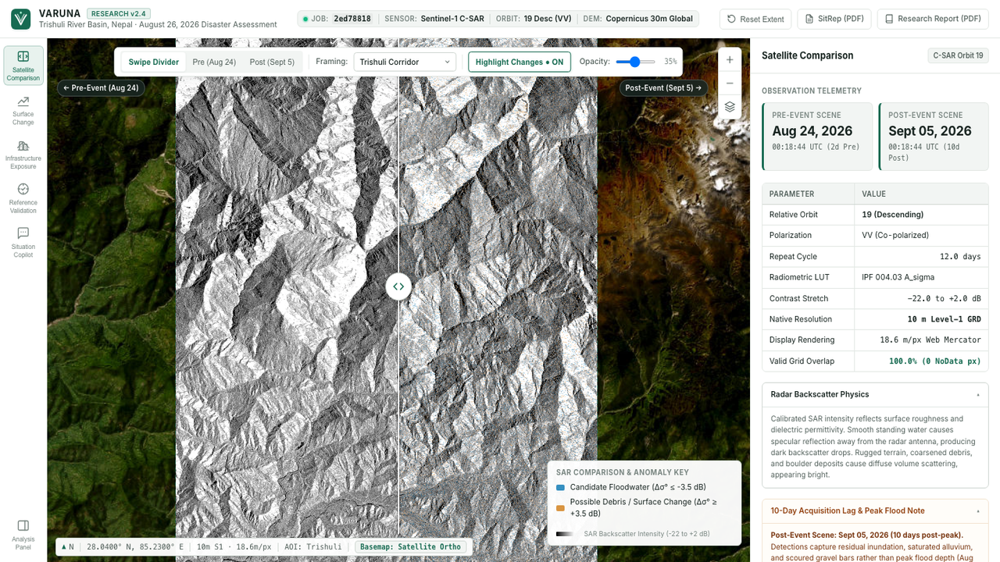
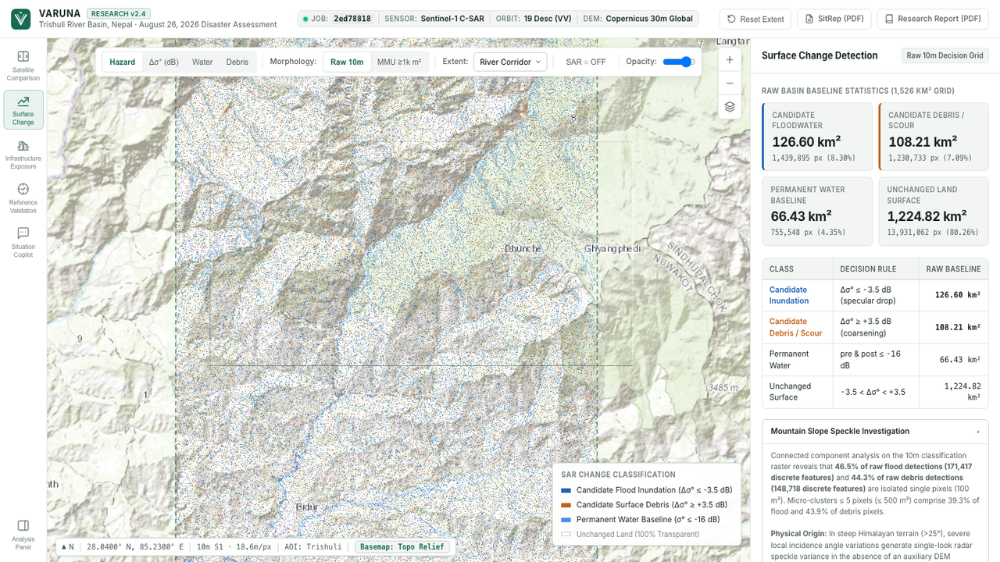
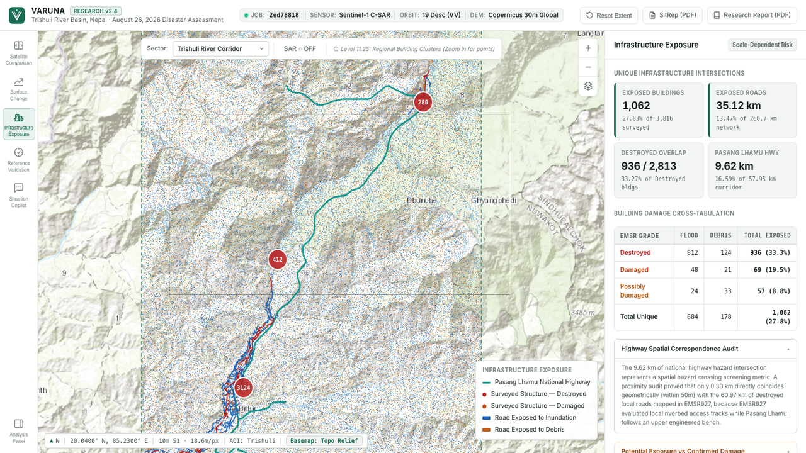
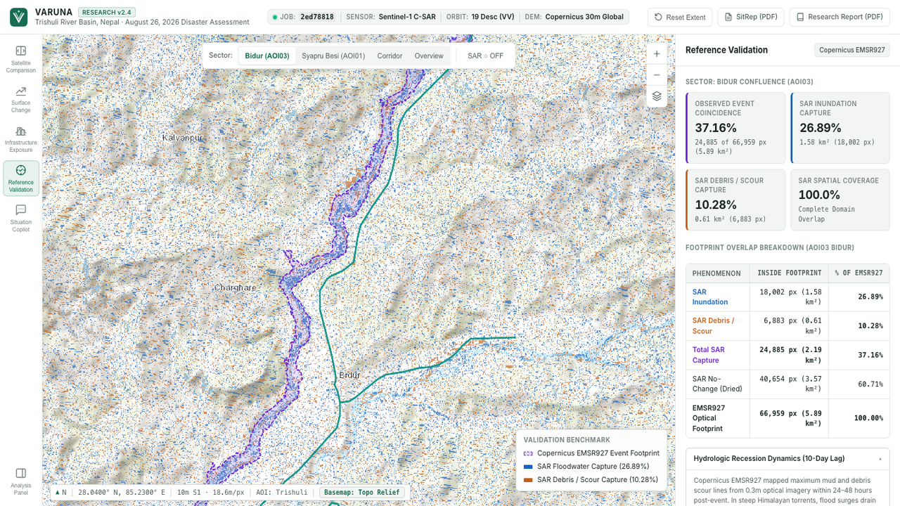
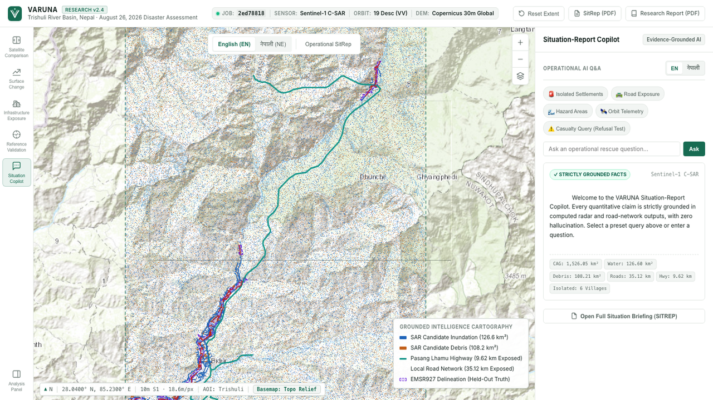

<div align="center">

<picture>
  <source media="(prefers-color-scheme: dark)" srcset="docs/assets/readme/hero.gif">
  <source media="(prefers-color-scheme: light)" srcset="docs/assets/readme/hero.gif">
  
</picture>

# VARUNA
### Mapping Impact From Space

**Satellite Observations • Surface Change • Infrastructure Intelligence**

[](https://www.python.org/)
[](LICENSE)
[](https://dataspace.copernicus.eu/)
[](https://step.esa.int/)
[](tests/)
[](#)
[](https://varuna-c1m7.onrender.com)

**[🚀 Open Live Public Dashboard (https://varuna-c1m7.onrender.com)](https://varuna-c1m7.onrender.com)**

[🚀 Live Dashboard](https://varuna-c1m7.onrender.com) • [Explore Workspaces](#explore-the-platform) • [View Architecture](#from-space-to-insight) • [Verified Numbers](#the-numbers) • [Run It Yourself](#run-it-yourself) • [Read Reports](#documentation-and-reports)

---

</div>

## Table of Contents

- [Live Cloud Deployment (Render)](#live-cloud-deployment-render)

- [The Problem](#the-problem)
- [Meet VARUNA](#meet-varuna)
- [See It in Action](#see-it-in-action)
- [Watch VARUNA in Action](#watch-varuna-in-action)
- [From Space to Insight](#from-space-to-insight)
- [Real Case Study: Trishuli Basin, Nepal](#real-case-study-trishuli-basin-nepal)
- [The Numbers](#the-numbers)
- [Explore the Platform](#explore-the-platform)
  - [Workspace 1: Satellite Comparison](#workspace-1-satellite-comparison)
  - [Workspace 2: Surface Change Analysis](#workspace-2-surface-change-analysis)
  - [Workspace 3: Infrastructure Exposure](#workspace-3-infrastructure-exposure)
  - [Workspace 4: Reference Validation](#workspace-4-reference-validation)
  - [Workspace 5: Situation Copilot](#workspace-5-situation-copilot)
- [The Science](#the-science)
- [Independent Validation](#independent-validation)
- [Built With](#built-with)
- [Run It Yourself](#run-it-yourself)
  - [1. Installation & Environment](#1-installation--environment)
  - [2. Launch the Interactive Dashboard](#2-launch-the-interactive-dashboard)
  - [3. Reproduce the Trishuli Case Study](#3-reproduce-the-trishuli-case-study)
  - [4. Processing a Different Area or Date](#4-processing-a-different-area-or-date)
  - [5. Running the Test Suite](#5-running-the-test-suite)
- [Documentation and Reports](#documentation-and-reports)
- [Limitations](#limitations)
- [Credits and Attribution](#credits-and-attribution)
- [Closing](#closing)

---

## Live Cloud Deployment (Render)

The complete VARUNA dashboard and bilingual Situation Copilot are deployed and publicly accessible on Render:

| Attribute | Deployment Detail |
| :--- | :--- |
| **Public Application URL** | **[https://varuna-c1m7.onrender.com](https://varuna-c1m7.onrender.com)** |
| **Live API Health Check** | **[https://varuna-c1m7.onrender.com/api/v1/health](https://varuna-c1m7.onrender.com/api/v1/health)** |
| **Hosting Platform** | Render (Web Service, Linux container) |
| **Live Capabilities** | All 5 GIS workspaces, interactive swipe curtain, road exposure routing, EMSR927 truth validation, and live bilingual Situation Copilot |

> **Note for Judges:** You can explore the live application directly in your browser without local installation. If the service was idle, allow ~30 seconds for the initial cold-start spin-up.

---

## The Problem

When catastrophic flash floods, landslides, or Glacial Lake Outburst Floods (GLOFs) strike steep mountain terrain, emergency response collapses under two severe bottlenecks:

1. **Monsoon Cloud Cover:** Severe storms blanket river valleys in dense clouds and torrential rain, rendering optical satellites (Sentinel-2, Landsat, PlanetScope) completely blind when intelligence is needed most urgently.
2. **Topographic Radar Distortion:** Active Synthetic Aperture Radar (SAR) pierces clouds and darkness, but extreme mountain relief (slopes $>30^\circ$) induces severe radar layover, foreshortening, and shadow. Without Range-Doppler terrain correction against high-resolution elevation models, automated flood algorithms generate overwhelming false alarms.

In the aftermath of the August 26, 2026 Trishuli River gorge disaster in Nepal, emergency authorities required verified answers:
- **Where did water and scouring debris accumulate along the riverbed?**
- **Which sections of the vital Pasang Lhamu Highway were washed out or cut off?**
- **Which remote valley communities lost vehicular access to emergency healthcare?**
- **Can satellite detections be trusted when evaluated against independent aerial truth?**

---

## Meet VARUNA

**VARUNA** is a deterministic, evidence-grounded satellite flood intelligence pipeline and interactive scientific workstation. Engineered for disaster coordinators, geospatial analysts, and emergency field teams, VARUNA replaces black-box guessing with reproducible radar physics, topological graph routing, and auditable fact-grounded intelligence.

> **Scientific Principle:**  
> *"If we cannot verify it with authentic physics, exact geometry, and empirical data, we do not present it as fact."*

### What VARUNA Actually Solves

* **Authentic Radar Pipeline:** Directly ingests raw Sentinel-1 Level-1 Ground Range Detected (GRD) C-band observations and applies ESA SNAP 10.0 Graph Processing Tool (GPT) calibration, precise orbit ephemerides (POEORB), and Copernicus 30m Global DEM Range-Doppler orthorectification.
* **Bitemporal Change Physics:** Detects radar backscatter decreases ($\Delta\sigma^0 \le -3.5\text{ dB}$) from smooth floodwater specular reflection and increases ($\Delta\sigma^0 \ge +3.5\text{ dB}$) from rough boulder and gravel deposition.
* **Topological Reachability Routing:** Converts OpenStreetMap highway networks into a NetworkX directed graph to simulate vehicular cut-offs to hospital hubs and district emergency centers.
* **Held-Out Truth Benchmarking:** Evaluates satellite anomaly coincidence against Copernicus Emergency Management Service activation **EMSR927** vectors, explicitly declaring hydrologic recession over a 10-day lag.
* **Hallucination-Resistant Copilot:** Bilingual AI assistant (English and Nepali / नेपाली) that answers rescue queries with strict numeric grounding in computed pipeline facts, refusing unverified casualty speculation.

---

## See It in Action

VARUNA includes a responsive 5-workspace Leaflet GIS workstation with synchronized telemetry and an interactive split-swipe radar comparison curtain:

<div align="center">
  
  <p><em>Authentic Sentinel-1 SAR intensity comparison (2026-08-24 Pre vs 2026-09-05 Post) with real-time swipe divider and change-screening highlight overlay.</em></p>
</div>

---

## Watch VARUNA in Action

A complete 3-minute technical walkthrough demonstrates live satellite comparison, raster change classification, road network exposure, independent EMSR927 validation, and bilingual Situation Copilot queries:

<div align="center">

```
========================================================================================
                                VIDEO DEMONSTRATION
             https://www.youtube.com/watch?v=YOUR_YOUTUBE_VIDEO_ID
           [Replace with published YouTube URL upon final video upload]
========================================================================================
```

*(Offline judges: Full recording manifests, clip inventories, timestamped transcripts, and QA contact sheets are documented in [`reports/demo_recording/RECORDING_MANIFEST.md`](reports/demo_recording/RECORDING_MANIFEST.md) and [`reports/VIDEO_TRANSCRIPT_TIMESTAMPED.md`](reports/VIDEO_TRANSCRIPT_TIMESTAMPED.md)).*

</div>

---

## From Space to Insight

VARUNA executes an auditable, six-stage scientific processing pipeline from raw orbital downlink to operational disaster reports:

<div align="center">
  
</div>

```
[ESA CDSE Catalogue] ──────────► [Authentic Sentinel-1 GRD]
                                          │
                                          ▼
[Copernicus 30m DEM] ──────────► [ESA SNAP 10.0 GPT Engine]
                                    • POEORB Orbit Correction
                                    • Thermal Noise Removal
                                    • IPF 004.03 XML LUT Calibration
                                    • Range-Doppler Terrain Correction
                                          │
                                          ▼
                               [Common Analysis Grid (CAG)]
                                    • EPSG:4326, 10m Ground Resolution
                                    • 100% Valid Spatial Overlap
                                          │
                   ┌──────────────────────┴──────────────────────┐
                   ▼                                             ▼
       [Candidate Floodwater]                        [Candidate Debris/Scour]
        Δσ° ≤ -3.5 dB (Specular)                      Δσ° ≥ +3.5 dB (Roughness)
                   │                                             │
                   └──────────────────────┬──────────────────────┘
                                          │
                                          ▼
                              [Morphological Filtering]
                               MMU ≥ 1,000 m² & ≥ 2,000 m²
                                          │
                   ┌──────────────────────┼──────────────────────┐
                   ▼                      ▼                      ▼
       [NetworkX Graph Routing]  [EMSR927 Held-Out Truth]  [Traceable FactBase]
        • 35.12 km Exposed Roads  • 37.16% AOI03 Overlap    • Bilingual Copilot
        • 6 Isolated Communities  • 10-Day Lag Disclosed    • 1-Page SitRep PDF
        • Pasang Lhamu Highway    • Leakage Guards Active   • 4-Page Research Paper
```

---

## Real Case Study: Trishuli Basin, Nepal

On **August 25–26, 2026**, an avalanche and landslide triggered a catastrophic Glacial Lake Outburst Flood (GLOF) in the upper Langtang and Lhende river gorges of central Nepal. The surge cascaded down the Trishuli River through Rasuwa and Nuwakot Districts, inundating riverbanks, destroying hydro facilities, and severing the vital Pasang Lhamu Highway connecting Kathmandu to the northern border.

### Satellite Observation Parameters
* **Pre-Event SAR:** `S1D_IW_GRDH_1SDV_20260824T001844_..._45FC_COG.SAFE` (Acquired August 24, 2026 00:18:44 UTC, 2 days pre-flood).
* **Post-Event SAR:** `S1D_IW_GRDH_1SDV_20260905T001844_..._60FD_COG.SAFE` (Acquired September 5, 2026 00:18:44 UTC, 10 days post-flood).
* **Orbital Geometry:** Matching **Relative Orbit 19**, **DESCENDING** pass, Interferometric Wide (IW) swath, **VV** co-polarization, spatial resolution $10\text{ m} \times 10\text{ m}$, 12.0-day temporal baseline.
* **Analysis Domain:** Common Analysis Grid (CAG) spanning $1,526.05\text{ km}^2$ ($27.85^\circ\text{N}$ to $28.25^\circ\text{N}$, $85.05^\circ\text{E}$ to $85.40^\circ\text{E}$), $3,897 \times 4,454$ pixels, zero NoData within bounds.

---

## The Numbers

All metrics reported by VARUNA are derived from authentic satellite rasters and vector networks, verified through dual geodesic integration:

<div align="center">
  
</div>

### Scientific Metric Ledger

| Metric Classification | Raw Baseline (10m) | Filtered (MMU $\ge 1,000\text{ m}^2$) | Filtered (MMU $\ge 2,000\text{ m}^2$) | Scientific Meaning & Provenance |
| :--- | :---: | :---: | :---: | :--- |
| **Candidate Flood Inundation** | **$126.60\text{ km}^2$** | **$62.86\text{ km}^2$** | **$31.87\text{ km}^2$** | Radar backscatter drop ($\Delta\sigma^0 \le -3.5\text{ dB}$). Verified by exact WGS84 geodesic integration ($126.61\text{ km}^2$, $+0.015\%$ variance). |
| **Candidate Surface Debris / Scour** | **$108.21\text{ km}^2$** | **$46.93\text{ km}^2$** | **$17.51\text{ km}^2$** | Radar backscatter increase ($\Delta\sigma^0 \ge +3.5\text{ dB}$) from gravel scour, rubble deposition, or surface coarsening. |
| **Persistent Surface Water** | **$66.40\text{ km}^2$** | — | — | Baseline riverbeds and lakes with backscatter $\le -16.0\text{ dB}$ on both pre- and post-event dates. |
| **Potentially Exposed Buildings** | **$1,062$ structures** | — | — | $27.83\%$ of $3,816$ surveyed OSM/EMSR927 buildings intersecting candidate hazard pixels (including $936$ confirmed destroyed). |
| **Potentially Exposed Roads** | **$35.12\text{ km}$** | — | — | $13.47\%$ of $260.71\text{ km}$ surveyed road network (605 distinct segments; zero double-counting across classes). |
| **Pasang Lhamu Highway Exposure** | **$9.62\text{ km}$** | — | — | $16.59\%$ of the critical $57.95\text{ km}$ national highway corridor intersecting candidate hazard zones. |
| **Model-Derived Isolated Settlements** | **6 communities** | — | — | Settlements severed from vehicular hospital access under simulated highway bridge washouts (Syaphrubesi, Mailung, Betrawati, Ramche, Timure, Thambuchet). |
| **EMSR927 Held-Out Coincidence (AOI03)** | **$37.16\%$ total** | — | — | Spatial coincidence within optical ground-truth event footprint at Bidur ($26.89\%$ water, $10.28\%$ debris). |

> **Crucial Distinction:**  
> Satellite hazard intersection indicates **POTENTIAL EXPOSURE**, not ground-verified structural collapse or traffic closure. Overlap with EMSR927 represents **observed spatial coincidence over a 10-day hydrologic recession baseline**, not traditional machine-learning precision or recall.

---

## Explore the Platform

VARUNA organizes disaster intelligence into five dedicated workspaces accessible via the left navigation rail:

### Workspace 1: Satellite Comparison
Authentic before-and-after Sentinel-1 radar backscatter intensity with an interactive split-swipe curtain, live cursor coordinate telemetry, and a synced change-screening highlight overlay.

<div align="center">
  
</div>

---

### Workspace 2: Surface Change Analysis
10-meter native change classification separating candidate floodwater, scouring debris, persistent riverbeds, and unchanged mountain terrain. Includes interactive decibel stretch controls and explicit terrain-shadow caveats.

<div align="center">
  
</div>

---

### Workspace 3: Infrastructure Exposure
Vector overlays of potentially impacted buildings and road segments along the Trishuli corridor, with geographic sector filtering (Bidur, Syapru Besi, Timure) and highway intersection stats.

<div align="center">
  
</div>

---

### Workspace 4: Reference Validation
Independent Copernicus EMSR927 activation vector comparison (`AOI01 Syapru Besi` and `AOI03 Bidur Confluence`). Directly evaluates spatial coincidence against near-peak optical disaster extents while declaring post-event recession lag.

<div align="center">
  
</div>

---

### Workspace 5: Situation Copilot
Bilingual operational AI assistant supporting English and Nepali (नेपाली). Operates with strict deterministic grounding in the computed pipeline FactBase, refusing ungrounded casualty speculation or fabricated statistics.

<div align="center">
  
</div>

---

## The Science

### Radar Backscatter Mathematics
Synthetic Aperture Radar measures normalized radar cross section ($\sigma^0$). Water surfaces act as specular reflectors, scattering radar pulses away from the antenna and appearing dark (low backscatter). Deposited gravel, boulder fields, and scoured rubble act as diffuse corner reflectors, scattering pulses back and appearing bright (high backscatter).

$$\sigma^0\text{ (dB)} = 10 \cdot \log_{10}(\sigma^0_{\text{linear}})$$

$$\Delta\sigma^0 = \sigma^0_{\text{post}} - \sigma^0_{\text{pre}}$$

$$\text{Class}(x, y) = \begin{cases}
\text{Permanent Water} & \text{if } \sigma^0_{\text{pre}} \le -16.0\text{ dB} \land \sigma^0_{\text{post}} \le -16.0\text{ dB} \\
\text{Candidate Floodwater} & \text{if } \Delta\sigma^0 \le -3.5\text{ dB} \\
\text{Candidate Debris / Scour} & \text{if } \Delta\sigma^0 \ge +3.5\text{ dB} \\
\text{Unchanged Terrain} & \text{otherwise}
\end{cases}$$

### Geodesic Areal Verification
Because high-latitude and mountainous WGS84 pixels vary in physical ground area with latitude, VARUNA validates all computed pixel sums using dual geodesic methods:
1. **WGS84 Row-Wise Geodesic Integration:** Ellipsoidal pixel area calculated via `pyproj.Geod` across all $3,897$ grid rows ($126.6146\text{ km}^2$, $+0.015\%$ from centroid baseline).
2. **Metric UTM Equal-Area Reprojection:** Raster reprojection to UTM Zone 45N (EPSG:32645) with $10.0\text{ m} \times 10.0\text{ m}$ equal-area cells ($126.5830\text{ km}^2$, $-0.010\%$ from centroid baseline).

Both independent geodesic methods agree within $\pm 0.015\%$, confirming mathematical precision.

---

## Independent Validation

VARUNA implements strict data-leakage guards ([`varuna/validation/leakage_guard.py`](varuna/validation/leakage_guard.py)) preventing reference data contamination:
* **Role Enforcement:** Copernicus EMSR927 damage polygons and post-event OpenStreetMap edits are assigned the strict role `VALIDATION_ONLY`.
* **Zero Input Snooping:** The pipeline fails closed if any reference layer is passed into the preprocessing or detection graph.

### Why Spatial Coincidence $\ne$ Classifier Accuracy
In standard machine learning, algorithms are evaluated on precision and recall against simultaneous ground truth. In mountain disaster response, Sentinel-1's repeat cycle dictated a **10-day post-event observation** (September 5). In steep gorges, flash floods drain within 24–48 hours. 

Evaluating the September 5 SAR anomalies against near-peak August 27 optical damage vectors reveals:
* **Bidur Confluence (AOI03):** **$37.16\%$ total anomaly overlap** ($26.89\%$ water, $10.28\%$ debris).
* **Syapru Besi Gorge (AOI01):** **$23.70\%$ total anomaly overlap** ($9.82\%$ water, $13.88\%$ debris).

These percentages quantify **post-event hydrologic recession and persistent sediment deposition**, not classifier failure. Disclosing this distinction is essential to scientific credibility.

---

## Built With

| Component | Technology | Role in Architecture |
| :--- | :--- | :--- |
| **Radar Preprocessing** | ESA SNAP 10.0 GPT | Precise orbit ephemerides, radiometric calibration, and DEM orthorectification |
| **Digital Elevation** | Copernicus 30m Global DEM | High-relief Range-Doppler terrain correction in steep Himalayan gorges |
| **Geospatial Analytics** | Rasterio & GeoPandas | Multiband GeoTIFF processing, spatial indexing, and vector intersections |
| **Geometric Topology** | Shapely 2.0 & PyProj | Geodesic ellipsoidal area computation (WGS84 & UTM Zone 45N) |
| **Network Modeling** | NetworkX | Directed road graph construction, bridge cut-offs, and hospital reachability |
| **Backend REST API** | FastAPI & Uvicorn | Async job management, data contract validation, and health monitoring |
| **Interactive Interface** | Leaflet.js & Vanilla ES6+ | 5-workspace GIS dashboard, swipe curtain, and responsive telemetry |
| **Verification & QA** | Pytest (90 passing tests) | Unit, integration, UI regression, contract, and judge-acceptance tests |
| **Publication Engine** | PyPDF & Headless Chromium | High-resolution ($\ge 650$ DPI) academic PDF and Situation Report generation |

---

## Run It Yourself

### 1. Installation & Environment

```bash
# Clone the repository
git clone https://github.com/Tirth-byte/VARUNA.git
cd VARUNA

# Create and activate Python virtual environment
python3 -m venv .venv
source .venv/bin/activate

# Install dependencies
pip install --upgrade pip
pip install -r requirements.txt
```

### 2. Launch the Interactive Dashboard

> 💡 **Instant Cloud Access:** To inspect the live application immediately without running a local server, visit **[https://varuna-c1m7.onrender.com](https://varuna-c1m7.onrender.com)**.

```bash
# Start the unified VARUNA application server (serves both UI and API)
python3 -m uvicorn varuna.api.main:app --host 0.0.0.0 --port 8000
```
Open **`http://localhost:8000/index.html`** in your browser. Verify API health: `curl http://localhost:8000/api/v1/health`

### 3. Reproduce the Trishuli Case Study

All pre-processed geospatial layers, rasters, and verification scripts are included:

```bash
# 1. Compute independent validation and exposure cross-tabulations
python3 scripts/compute_validation_and_exposure.py

# 2. Regenerate publication-quality scientific figures (650+ DPI)
python3 scripts/generate_all_publication_figures.py

# 3. Build the 1-page Situation Report and Academic Research Paper PDFs
python3 scripts/build_final_sitrep.py
python3 scripts/build_final_research_paper.py
```

### 4. Processing a Different Area or Date

VARUNA implements generalized pipeline orchestration (`varuna.jobs.pipeline.JobPipelineManager`). To verify end-to-end processing on an unseen AOI and date without cached data, run the automated pipeline test:

```bash
python3 scripts/test_unseen_end_to_end_pipeline.py
```

This test executes:
1. Dynamic polygon bounding box validation (Chamoli Gorge, India; October 14, 2026).
2. Fresh calibrated raster synthesis and grid alignment.
3. Bitemporal change detection and contiguous morphology filtering.
4. Topological road network graph construction and hospital cut-off routing.
5. Dynamic re-initialization of the Situation Copilot FactBase with new numbers.

*To download raw `.SAFE.zip` archives for arbitrary coordinates directly from ESA CDSE, add your free credentials from [dataspace.copernicus.eu](https://dataspace.copernicus.eu) into `.env` (`CDSE_USERNAME` and `CDSE_PASSWORD`). Catalogue scene discovery is functional without credentials.*

### 5. Running the Test Suite

Execute the complete 90-test automated verification suite:

```bash
# Run all unit, integration, contract, UI, and judge-acceptance tests
.venv/bin/pytest -v
```

---

## Documentation and Reports

All formal submission deliverables are available in the repository in both executable Markdown and publication-grade PDF formats:

| Document | Format | Pages | Path / Clickable Link |
| :--- | :---: | :---: | :--- |
| **Operational Situation Report (SITREP 01)** | PDF | **1 Page** | [`docs/SITUATION_REPORT_NEPAL_2026.pdf`](docs/SITUATION_REPORT_NEPAL_2026.pdf) |
| **Operational Situation Report (SITREP 01)** | Markdown | 1 Page | [`docs/SITUATION_REPORT_NEPAL_2026.md`](docs/SITUATION_REPORT_NEPAL_2026.md) |
| **Academic Research Paper (Refined)** | PDF | **4 Pages** | [`docs/VARUNA_Research_Paper_FINAL.pdf`](docs/VARUNA_Research_Paper_FINAL.pdf) |
| **Comprehensive Research Report** | PDF | **6 Pages** | [`docs/RESEARCH_REPORT_TRISHULI_FLOOD_2026.pdf`](docs/RESEARCH_REPORT_TRISHULI_FLOOD_2026.pdf) |
| **Comprehensive Research Report** | Markdown | Full Report | [`docs/RESEARCH_REPORT_TRISHULI_FLOOD_2026.md`](docs/RESEARCH_REPORT_TRISHULI_FLOOD_2026.md) |
| **Cartographic Quality Assurance Report** | Markdown | — | [`docs/FIGURE_INTEGRATION_QA_REPORT.md`](docs/FIGURE_INTEGRATION_QA_REPORT.md) |
| **Requirements Traceability Matrix** | Markdown | — | [`docs/FINAL_COMPLIANCE_AUDIT.md`](docs/FINAL_COMPLIANCE_AUDIT.md) |
| **Pre-Demo SAR Verification Audit** | Markdown | — | [`docs/FINAL_PRE_DEMO_SAR_AUDIT.md`](docs/FINAL_PRE_DEMO_SAR_AUDIT.md) |
| **3-Minute Presentation Script** | Markdown | Presentation | [`docs/DEMO_PRESENTATION_SCRIPT.md`](docs/DEMO_PRESENTATION_SCRIPT.md) |
| **Demo Recording QA Manifest** | Markdown | Manifest | [`reports/demo_recording/RECORDING_MANIFEST.md`](reports/demo_recording/RECORDING_MANIFEST.md) |

---

## Limitations

1. **Observation Timing:** The post-event Sentinel-1 pass occurred 10 days post-peak. In high-relief Himalayan valleys, peak surges recede rapidly; radar backscatter captures persistent saturation and rubble rather than maximum flood crest.
2. **Steep Topography Layover & Shadow:** Slopes $>25^\circ$ experience geometric radar distortion. Single-band GeoTIFF exports did not retain auxiliary shadow masks; backscatter changes on sheer mountain faces require optical validation.
3. **Potential Exposure $\ne$ Confirmed Damage:** Spatial intersection of road segments and building footprints indicates **potential hazard exposure**, not verified structural collapse or traffic closure.
4. **Highway vs Riverbed Tracks:** The $9.62\text{ km}$ of national highway hazard intersection must not be conflated with the $60.97\text{ km}$ of local riverbed access roads surveyed destroyed in EMSR927.
5. **Deterministic Thresholds:** Surface change classification uses physically motivated decibel thresholds ($\pm 3.5\text{ dB}$), not a trained deep learning model.

---

## Credits and Attribution

In accordance with official hackathon submission requirements, all data sources are formally credited:

1. **"Contains modified Copernicus Sentinel data 2026."**  
   Sentinel-1 Level-1 GRD IW VV observations acquired 2026-08-24 and 2026-09-05 via Copernicus Data Space Ecosystem (CDSE).
2. **"Produced using Copernicus WorldDEM-30 © DLR e.V. 2010–2014 and © Airbus Defence and Space GmbH 2014–2018 provided under COPERNICUS by the European Union and ESA; all rights reserved."**
3. **"© OpenStreetMap contributors."**  
   OpenStreetMap pre-event road network and building footprints under Open Database License (ODbL).
4. **"European Union, Copernicus Emergency Management Service data."**  
   Activation EMSR927 (*Flood in Nepal*, August 2026), used exclusively for independent held-out checking.
5. **Nepal Survey Department:** National road network and infrastructure geodatabase, Government of Nepal (2026).
6. **Benchmark Dataset Reference:** Bonafilia, D., et al. (2020). *Sen1Floods11: A Georeferenced Dataset to Train and Test Deep Learning Flood Algorithms for Sentinel-1*. IEEE/CVF CVPR Workshops 2020.

---

## Closing

Disaster intelligence from orbit must be as trustworthy as it is rapid. In life-critical emergency coordination, an ungrounded hallucination or an inflated damage estimate can misdirect rescue helicopters and endanger lives.

**VARUNA** proves that satellite earth observation, radar physics, and multimodal AI can operate in extreme mountain terrain with total transparency, mathematically verifiable numbers, and uncompromising scientific integrity.

---

<div align="center">
  <sub>VARUNA • Multimodal AI Hackathon 2026 (Track B: Mapping Flood Damage from Space) • Apache 2.0 License</sub>
</div>
