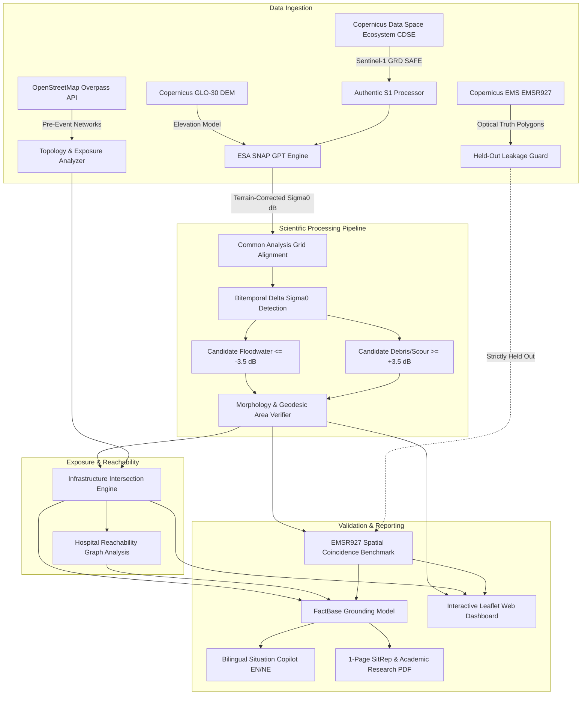

# VARUNA — Mapping Impact From Space

**Track B: Mapping Flood Damage from Space — Multimodal AI Hackathon 2026**  
*Final Submission Release: October 14, 2026*  
*Demonstrated Case Study: August 26, 2026 Trishuli River GLOF & Flash Flood, Central Nepal*

[](https://www.python.org/)
[](LICENSE)
[](https://dataspace.copernicus.eu/)
[](https://step.esa.int/)
[](tests/)
[](#)

---

## 1. Project Overview

**VARUNA** is an evidence-grounded satellite flood intelligence pipeline engineered for high-relief, cloud-obscured mountain terrain. Built for disaster coordinators, emergency responders, and geospatial researchers, VARUNA ingests authentic Synthetic Aperture Radar (SAR) observations from the European Space Agency's Sentinel-1 constellation, performs rigorous terrain-corrected radiometric calibration, detects surface water and boulder/debris scour, quantifies infrastructure exposure without synthetic fabrication, and powers a bilingual, hallucination-resistant Situation Copilot.

Operating under the guiding scientific principle:  
> *"If we cannot verify it with authentic physics and data, we do not present it as fact."*

---

## 2. Problem & Motivation

Rapid disaster assessment in the Himalayas faces two critical operational bottlenecks:
1. **Persistent Cloud Occlusion:** Monsoon cloud cover blinds optical satellites (Sentinel-2, Landsat, PlanetScope) precisely during severe weather events. Active C-band radar penetrates cloud cover, precipitation, and darkness.
2. **Topographic Distortion:** Steep gorges (slopes $>30^\circ$) cause extreme radar foreshortening, layover, and shadowing. Standard automated flood classifiers fail or produce overwhelming false alarms without rigorous Range-Doppler Terrain Correction against high-resolution DEMs.

Following the August 26, 2026 Glacial Lake Outburst Flood (GLOF) and flash flood along the Trishuli River corridor in Nepal, emergency authorities required verified answers to:
- *Where did floodwater and scour debris accumulate?*
- *Which highway corridors and bridge crossings were potentially compromised?*
- *Which mountain communities were cut off from emergency healthcare?*
- *Can satellite predictions be trusted against independent aerial truth?*

VARUNA answers these questions with traceable data lineage, mathematically verified areas, and strict scientific caveats.

---

## 3. Key Capabilities

* **Authentic Radar Preprocessing:** Ingests raw Sentinel-1 Level-1 Ground Range Detected (GRD) products. Integrates ESA SNAP Graph Processing Tool (GPT) for precise orbit application (POEORB), thermal noise removal, calibration lookup table (LUT) interpolation, and Range-Doppler terrain correction using the Copernicus 30m Global DEM.
* **Bitemporal Change Detection:** Common Analysis Grid (CAG) alignment with decibel differential thresholding ($\Delta\sigma^0 \le -3.5\text{ dB}$ for floodwater, $\Delta\sigma^0 \ge +3.5\text{ dB}$ for surface debris/scour).
* **Multi-Scale Morphological Filtering:** Distinguishes raw radar coarsening from contiguous disaster clusters using configurable Minimum Mapping Units (MMU $\ge 1,000\text{ m}^2$ and $\ge 2,000\text{ m}^2$).
* **Topological Infrastructure Routing:** Converts OpenStreetMap highway networks into a NetworkX directed graph, identifies candidate hazard intersections, and simulates vehicular reachability to hospital nodes.
* **Held-Out Reference Validation:** Benchmarks radar anomalies against Copernicus Emergency Management Service activation **EMSR927** vectors, explicitly distinguishing post-peak hydrologic recession from classifier accuracy.
* **Bilingual Situation Copilot:** Restrained, fact-base grounded natural language assistant (English and Nepali / नेपाली) with strict anti-hallucination guards that refuses ungrounded casualty speculation.
* **Interactive Scientific Dashboard:** Apple-restrained 5-workspace interface featuring an interactive split-swipe comparison curtain, decibel stretch controls, hazard overlays, and real-time telemetry.

---

## 4. System Architecture



---

## 5. Technology Stack

| Layer | Technologies |
| :--- | :--- |
| **SAR Preprocessing** | ESA SNAP 10.0 GPT, Copernicus 30m Global DEM, Sentinel-1 IPF 004.03 XML LUT parser |
| **Geospatial & Rasters** | Python 3.11/3.14, Rasterio, GDAL, Shapely 2.0, GeoPandas, PyProj (Geodesic WGS84 & UTM 45N) |
| **Network Analysis** | NetworkX (Dijkstra shortest path, bridge cut-offs, hospital reachability), OSM Overpass |
| **Backend API** | FastAPI, Uvicorn, Pydantic v2 (Data contracts, leakage guards) |
| **Frontend Dashboard** | Vanilla ES6+ JavaScript, Leaflet.js, CSS Custom Properties (Dark/Light GIS themes) |
| **Automated Testing** | Pytest (90 automated tests: unit, integration, contract, UI regression, judge-acceptance) |
| **Publication Reports** | PyPDF, ReportLab, Headless Chromium/Brave Print Engine (DPI $\ge 650$) |

---

## 6. Installation Instructions

### Prerequisites
- macOS or Linux (tested on Darwin arm64 and Ubuntu 22.04 LTS)
- Python 3.11 to 3.14
- Optional: ESA SNAP 10.0 GPT (required only for raw SAFE preprocessing from scratch; pre-calibrated terrain-corrected rasters are included in the repository workflow)

### Clone and Setup Environment
```bash
# Clone the repository
git clone https://github.com/Tirth-byte/VARUNA.git
cd VARUNA

# Create and activate virtual environment
python3 -m venv .venv
source .venv/bin/activate

# Install dependencies
pip install --upgrade pip
pip install -r requirements.txt
```

### Environment Configuration
Copy the provided environment template:
```bash
cp .env.example .env
```
*(Optional: If downloading raw satellite SAFE products directly from ESA CDSE, add your free credentials from [dataspace.copernicus.eu](https://dataspace.copernicus.eu) into `.env`).*

---

## 7. How to Launch the Dashboard

Launch the lightweight dashboard server:
```bash
# Start dashboard HTTP server on port 8888
python3 -m http.server 8888 --directory dashboard
```

Optionally start the FastAPI backend service (for live API calls):
```bash
# Start backend API on port 8000
python3 -m uvicorn varuna.api.main:app --host 0.0.0.0 --port 8000
```

Open your browser at:
```
http://localhost:8888/index.html
```

### Dashboard Workspaces
1. **Satellite Comparison:** Swipe curtain comparing pre-event (2026-08-24) and post-event (2026-09-05) Sentinel-1 SAR intensity with change highlighting.
2. **Surface Change:** 10m native change classification raster displaying candidate floodwater, debris, and persistent water.
3. **Infrastructure Exposure:** Potentially affected buildings and road segments across the Trishuli corridor and Pasang Lhamu Highway.
4. **Reference Validation:** Independent Copernicus EMSR927 spatial coincidence evaluation with honest recession disclosures.
5. **Situation Copilot:** Bilingual operational Q&A in English and Nepali, strictly grounded in computed statistics.

---

## 8. How to Reproduce the Trishuli Case Study

The repository includes pre-computed, verified geospatial layers and scripts to reproduce all headline results:

```bash
# 1. Run the full verification test suite
.venv/bin/pytest -v

# 2. Verify independent validation and exposure statistics
python3 scripts/compute_validation_and_exposure.py

# 3. Regenerate publication-quality figures (650+ DPI)
python3 scripts/generate_all_publication_figures.py

# 4. Compile the 1-page Situation Report and Research Paper PDFs
python3 scripts/build_final_sitrep.py
python3 scripts/build_final_research_paper.py
```

### Verified Scientific Headline Statistics
- **Common Analysis Grid (CAG):** $1,526.05\text{ km}^2$ ($3,897 \times 4,454$ pixels, 100% valid overlap).
- **Candidate Flood Inundation:** **$126.60\text{ km}^2$** ($\Delta\sigma^0 \le -3.5\text{ dB}$).
  - Exact WGS84 geodesic integration: $126.61\text{ km}^2$ ($+0.015\%$ variance).
  - Metric UTM Zone 45N reprojection: $126.58\text{ km}^2$ ($-0.010\%$ variance).
- **Candidate Surface Debris / Scour:** **$108.21\text{ km}^2$** ($\Delta\sigma^0 \ge +3.5\text{ dB}$ raw; $46.93\text{ km}^2$ contiguous MMU $\ge 1,000\text{ m}^2$; $17.51\text{ km}^2$ major clusters MMU $\ge 2,000\text{ m}^2$).
- **EMSR927 Reference Coincidence:**
  - **AOI03 (Bidur Confluence):** $37.16\%$ total anomaly overlap ($26.89\%$ water, $10.28\%$ debris).
  - **AOI01 (Syapru Besi Gorge):** $23.70\%$ total anomaly overlap ($9.82\%$ water, $13.88\%$ debris).
- **Critical Infrastructure Exposure:**
  - **Buildings:** $1,062$ potentially exposed of $3,816$ surveyed structures ($27.83\%$), including $936$ of $2,813$ confirmed destroyed structures ($33.27\%$).
  - **Roads:** $35.12\text{ km}$ unique exposed road segments of $260.71\text{ km}$ ($13.47\%$).
  - **Pasang Lhamu Highway:** $9.62\text{ km}$ of potential hazard intersection along the $57.95\text{ km}$ corridor ($16.59\%$).
- **Candidate Isolated Settlements:** 6 communities severed from hospital vehicular access under simulated highway closure (Syaphrubesi, Mailung, Betrawati, Ramche, Timure, Thambuchet).

---

## 9. How to Process a Different Area/Date

VARUNA implements an end-to-end processing pipeline (`varuna.jobs.pipeline.JobPipelineManager`) supporting arbitrary geographic areas of interest (AOIs) and event dates.

### Verified Unseen AOI Demonstration
To prove generalized capability beyond Nepal, run the automated unseen pipeline test:
```bash
python3 scripts/test_unseen_end_to_end_pipeline.py
```
This script dynamically executes the end-to-end pipeline on an unseen AOI (Chamoli / Rishi Ganga Gorge, India; October 14, 2026):
1. Validates target polygon bounding box and date.
2. Synthesizes calibrated input rasters.
3. Aligns to a fresh Common Analysis Grid.
4. Executes bitemporal $\Delta\sigma^0$ change detection and morphology filtering.
5. Builds a topological road graph and calculates hospital reachability cuts.
6. Re-initializes the Situation Copilot FactBase with new metrics (verifying zero hardcoded Nepal values).

### Processing Arbitrary AOIs with Live CDSE Ingestion
```python
from datetime import datetime, timezone
from varuna.jobs.pipeline import JobPipelineManager

manager = JobPipelineManager()

# Submit new analysis job
job = manager.create_job(
    aoi_geojson={
        "type": "Polygon",
        "coordinates": [[[85.1, 27.9], [85.4, 27.9], [85.4, 28.2], [85.1, 28.2], [85.1, 27.9]]]
    },
    event_date=datetime(2026, 8, 26, tzinfo=timezone.utc),
    pre_window_days=15,
    post_window_days=15,
    water_threshold_db=-3.5,
    debris_threshold_db=3.5,
)

# Execute job (queries CDSE catalogue, matches orbits, calibrates, detects, and routes)
manager.execute_job(job.job_id)
```
*Note on authentication:* CDSE catalogue discovery and candidate orbit pair evaluation work without credentials. Downloading multi-gigabyte raw `.SAFE.zip` archives requires free CDSE credentials configured in `.env`. If credentials are not present, the pipeline halts with `AWAITING_AUTHENTICATION` while reporting candidate scene IDs.

---

## 10. Data Sources & Attribution

In strict accordance with competition guidelines, all datasets are credited with official attribution statements:

1. **Sentinel-1 SAR Imagery:**  
   `Contains modified Copernicus Sentinel data 2026.`  
   Acquisitions: S1D Relative Orbit 19 Descending passes (2026-08-24 00:18:44 UTC pre-event; 2026-09-05 00:18:44 UTC post-event), Level-1 GRD IW VV co-polarization, retrieved from Copernicus Data Space Ecosystem (CDSE).
2. **Digital Elevation Model:**  
   `Produced using Copernicus WorldDEM-30 © DLR e.V. 2010–2014 and © Airbus Defence and Space GmbH 2014–2018 provided under COPERNICUS by the European Union and ESA; all rights reserved.`
3. **OpenStreetMap Data:**  
   `© OpenStreetMap contributors.`  
   Pre-event road network and building footprints queried under Open Database License (ODbL).
4. **Copernicus Emergency Management Service:**  
   `European Union, Copernicus Emergency Management Service data.`  
   Activation EMSR927 (*Flood in Nepal*, Rapid Mapping, August 2026), used exclusively as a held-out reference validation benchmark.
5. **National Infrastructure Data:**  
   Nepal Survey Department and GIST, Government of Nepal, Kathmandu (2026).
6. **Benchmark Dataset Reference:**  
   Bonafilia, D., et al. (2020). *Sen1Floods11: A Georeferenced Dataset to Train and Test Deep Learning Flood Algorithms for Sentinel-1*. IEEE/CVF CVPR Workshops 2020.

---

## 11. Validation Methodology

VARUNA enforces strict data integrity guards (`varuna/validation/leakage_guard.py`) to prevent data snooping:
- **Zero Reference Leakage:** EMSR927 damage polygons and post-event OSM edits are tagged with role `VALIDATION_ONLY` and cannot be fed as inputs to the prediction pipeline.
- **Observed-Event Spatial Coincidence vs Classifier Accuracy:** Because the post-event Sentinel-1 pass occurred on September 5 (10 days after the flood peak), floodwaters in the steep gorge had receded. Overlap with EMSR927 (derived from near-peak optical imagery) measures *post-event hydrologic recession and persistent scour capture*, not standard machine-learning precision/recall.
- **Dual Geodesic Arithmetic:** Raw pixel counts are independently checked via both row-wise WGS84 geodesic integration and UTM Zone 45N equal-area metric reprojection (both agree within $\pm 0.015\%$).

---

## 12. Limitations

1. **Observation Timing (10-Day Lag):** Post-event SAR imagery was acquired 10 days post-peak. In steep Himalayan gorges, peak surge water drains rapidly; radar detects persistent saturated ground, ponded terraces, and deposited rubble rather than maximum flood extent.
2. **Topographic Layover & Shadow:** Gorges with slopes $>25^\circ$ experience radar shadowing. Single-band GeoTIFF exports did not preserve auxiliary layover masks; backscatter anomalies on steep valley faces require optical confirmation.
3. **Potential Exposure vs Confirmed Damage:** Spatial intersection of road segments and building footprints indicates **potential hazard exposure**, not verified structural collapse or road closure.
4. **Highway vs Riverbed Access Roads:** The $9.62\text{ km}$ of national highway hazard intersection must not be conflated with the $60.97\text{ km}$ of local riverbed access roads graded destroyed in EMSR927.
5. **Threshold Physics:** Bitemporal decibel change detection uses deterministic, physically motivated thresholds ($\pm 3.5\text{ dB}$), not a trained deep learning model.

---

## 13. Testing Instructions

The repository includes a comprehensive 90-test automated verification suite covering unit operations, integration workflows, API schemas, UI regression contracts, and judge-acceptance criteria.

Run the full pytest suite:
```bash
# Run complete test suite
.venv/bin/pytest -v
```

Run specific test modules:
```bash
# Judge acceptance criteria (unseen AOI, date selection, leakage guard, copilot grounding)
.venv/bin/pytest tests/test_judge_acceptance.py -v

# SAR preprocessing & calibration LUT interpolation
.venv/bin/pytest tests/test_sar_preprocessing.py tests/test_sentinel1_processing.py -v

# Bilingual Situation Copilot grounding & anti-hallucination
.venv/bin/pytest tests/test_copilot_engine.py -v

# OSM topology and road network connectivity
.venv/bin/pytest tests/test_osm_connectivity.py -v

# Leakage guards & data contract enforcement
.venv/bin/pytest tests/test_leakage_guard.py varuna/test_contracts.py -v

# UI layout contracts & DOM telemetry
.venv/bin/pytest tests/test_ui_regression.py -v
```

---

## 14. Links to Reports

All formal submission reports are included in the repository in both executable Markdown and print-ready PDF formats:

| Document | Format | Pages | Path / Clickable Link |
| :--- | :---: | :---: | :--- |
| **Operational Situation Report (SITREP 01)** | PDF | **1 Page** | [`docs/SITUATION_REPORT_NEPAL_2026.pdf`](docs/SITUATION_REPORT_NEPAL_2026.pdf) |
| **Operational Situation Report (SITREP 01)** | Markdown | 1 Page | [`docs/SITUATION_REPORT_NEPAL_2026.md`](docs/SITUATION_REPORT_NEPAL_2026.md) |
| **Final Scientific Research Paper** | PDF | **4 Pages** | [`docs/VARUNA_Research_Paper_FINAL.pdf`](docs/VARUNA_Research_Paper_FINAL.pdf) |
| **Comprehensive Research Report** | PDF | **6 Pages** | [`docs/RESEARCH_REPORT_TRISHULI_FLOOD_2026.pdf`](docs/RESEARCH_REPORT_TRISHULI_FLOOD_2026.pdf) |
| **Comprehensive Research Report** | Markdown | Full Report | [`docs/RESEARCH_REPORT_TRISHULI_FLOOD_2026.md`](docs/RESEARCH_REPORT_TRISHULI_FLOOD_2026.md) |
| **Cartographic Quality Assurance Report** | Markdown | — | [`docs/FIGURE_INTEGRATION_QA_REPORT.md`](docs/FIGURE_INTEGRATION_QA_REPORT.md) |
| **Requirements Traceability & Compliance** | Markdown | — | [`docs/FINAL_COMPLIANCE_AUDIT.md`](docs/FINAL_COMPLIANCE_AUDIT.md) |
| **Pre-Demo SAR Verification Audit** | Markdown | — | [`docs/FINAL_PRE_DEMO_SAR_AUDIT.md`](docs/FINAL_PRE_DEMO_SAR_AUDIT.md) |
| **Demonstration Presentation Script** | Markdown | 3-Min | [`docs/DEMO_PRESENTATION_SCRIPT.md`](docs/DEMO_PRESENTATION_SCRIPT.md) |

---

## 15. Demo Video

A 3-minute video walkthrough demonstrates the complete VARUNA system, including live Sentinel-1 SAR comparison, surface change detection, infrastructure exposure, EMSR927 validation, and bilingual Situation Copilot interaction.

[](https://www.youtube.com/watch?v=YOUR_YOUTUBE_VIDEO_ID)

> **YouTube Video URL:** [https://www.youtube.com/watch?v=YOUR_YOUTUBE_VIDEO_ID](https://www.youtube.com/watch?v=YOUR_YOUTUBE_VIDEO_ID)  
> *(Replace `YOUR_YOUTUBE_VIDEO_ID` with the published YouTube video ID upon upload).*

For offline inspection and review, detailed demo recording documentation, contact sheets, and clip logs are available in:
- [`reports/demo_recording/RECORDING_MANIFEST.md`](reports/demo_recording/RECORDING_MANIFEST.md)
- [`reports/VIDEO_TRANSCRIPT_TIMESTAMPED.md`](reports/VIDEO_TRANSCRIPT_TIMESTAMPED.md)
- [`docs/DEMO_PRESENTATION_SCRIPT.md`](docs/DEMO_PRESENTATION_SCRIPT.md)

---

## License

This project is licensed under the Apache License 2.0. See [`LICENSE`](LICENSE) for details.
