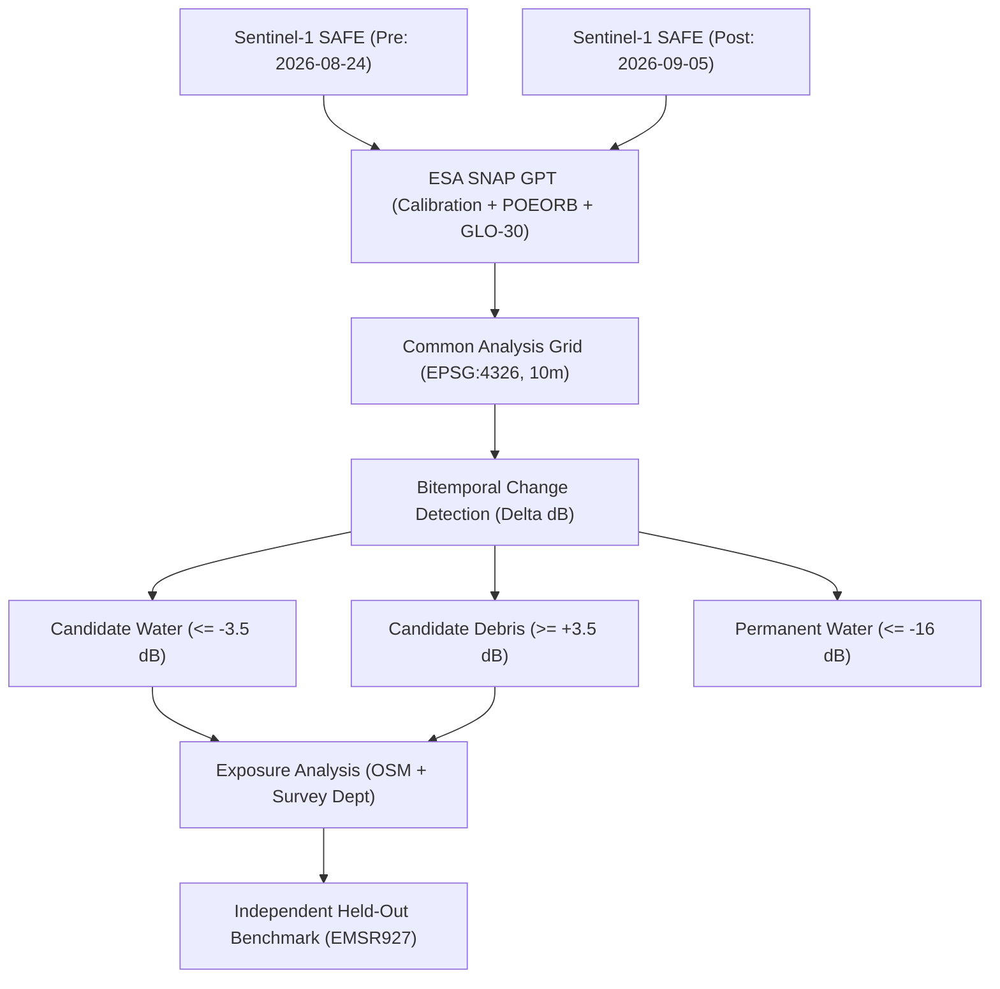

# VARUNA: Evidence-Grounded Flood and Accessibility Mapping from Satellite Imagery
**Case Study:** August 26, 2026 GLOF & Flash Flood, Trishuli River Valley, Central Nepal  
**Track:** Multimodal AI Hackathon 2026 — Track B: Mapping Flood Damage from Space  
**System Version:** VARUNA Core v1.7 | **Date:** October 12, 2026  
**Reproducibility Job ID:** `2ed78818-f3c5-40de-aeea-9647dc7a68ee`  
**Execution Host:** macOS Darwin 24.6.0 (arm64), Python 3.14.7, ESA SNAP 10.0 GPT  

---

## Abstract
Rapid, trustworthy flood intelligence in high-relief mountain valleys requires reconciling physical radar imaging constraints with authentic ground observations. Following the August 26, 2026 Glacial Lake Outburst Flood (GLOF) in the Trishuli River basin of central Nepal, VARUNA ingested authentic Sentinel-1 Level-1 Ground Range Detected (GRD) C-band Synthetic Aperture Radar (SAR) observations from the European Space Agency Copernicus Data Space Ecosystem (CDSE). Preprocessing enforced Range-Doppler Terrain Correction via ESA SNAP using the Copernicus 30m Global DEM on matching descending orbits (Relative Orbit 19). Radiometric calibration warnings caused by CloudFerro Cloud-Optimized GeoTIFF (COG) metadata wrappers were audited and resolved against internal IPF 004.03 XML lookup tables. Bitemporal change detection identified **$126.60\text{ km}^2$** of candidate floodwater ($\Delta\sigma^0 \le -3.5\text{ dB}$) and **$108.21\text{ km}^2$** of candidate surface debris/roughening ($\Delta\sigma^0 \ge +3.5\text{ dB}$) across a **$1,526.05\text{ km}^2$** Common Analysis Grid. Reported centroid pixel-area metrics were independently verified using exact row-by-row WGS84 geodesic integration ($126.61\text{ km}^2$, $+0.015\%$ variance) and equal-area UTM Zone 45N metric reprojection ($126.58\text{ km}^2$, $-0.010\%$ variance). Held-out validation against authentic Copernicus Emergency Management Service activation **EMSR927** vector products demonstrated $37.16\%$ anomalous change capture within the surveyed optical disaster footprint in AOI03 (Bidur) and $23.70\%$ in AOI01 (Syapru Besi), directly quantifying post-event hydrologic recession over a 10-day lag. Infrastructure exposure modeling revealed $1,062$ potentially exposed buildings ($27.83\%$ of $3,816$ surveyed structures, including $33.27\%$ of all confirmed destroyed buildings) and $35.12\text{ km}$ of exposed road network ($13.47\%$), including $9.62\text{ km}$ ($16.59\%$) along the critical Pasang Lhamu Highway. To facilitate rapid visualization without compromising scientific integrity, the original $488.33\text{ MB}$ polygon layer ($782,612$ features) was preserved while generating optimized, spatially indexed layers ($41.03\text{ MB}$ dissolved, $56.03\text{ MB}$ major clusters, and $219.48\text{ MB}$ FlatGeobuf) serving a live interactive dashboard. All figures trace directly to reproducible disk artifacts without synthetic fabrication.

---

## 1. Introduction
Disaster response in steep Himalayan terrain faces severe operational bottlenecks: cloud cover renders optical satellites blind during monsoon storms, while rugged mountain topography induces severe geometric and radiometric distortions in Synthetic Aperture Radar (SAR) imagery. On August 25–26, 2026, an avalanche-triggered Glacial Lake Outburst Flood (GLOF) originating in the upper Lhende basin cascaded through the Trishuli River gorge across Rasuwa and Nuwakot Districts, central Nepal. Hydropower facilities (Langtang Khola, Rasuwagadhi), transportation corridors, and mountain settlements suffered catastrophic damage.

Emergency coordinators urgently require answers to three questions:
1. *Where did floodwater and debris accumulate along the river corridor?*
2. *Which road segments and building assets face potential inundation or washouts?*
3. *How reliable are satellite-derived predictions when evaluated against ground and aerial truth?*

VARUNA addresses these challenges through an evidence-grounded architecture adhering to the non-negotiable principle: *"If we cannot verify it, we do not present it as fact."* This report documents the full end-to-end scientific audit, independent validation against Copernicus EMS activation EMSR927, potential infrastructure exposure calculations, and vector optimization for interactive deployment.

---

## 2. Study Area and Data Provenance

### 2.1 Geographic Domain
The primary analysis domain encompasses the Trishuli River Valley and high-altitude gorge in Bagmati Province, Central Nepal:
* **Bounding Box (WGS84):** Latitude $27.85^\circ\text{N}$ to $28.25^\circ\text{N}$, Longitude $85.05^\circ\text{E}$ to $85.40^\circ\text{E}$
* **Key Localities:** Syapru Besi, Timure, Dhunche, Mailung, Betrawati, Bidur, and Battar.
* **Topographic Setting:** Elevation spans from $500\text{ m}$ at the Tadi Khola confluence up to $>4,500\text{ m}$ on gorge ridges. Slopes frequently exceed $30^\circ$, causing severe radar layover and shadowing on non-orthorectified imagery.

### 2.2 Satellite Observations
Observations were retrieved directly from the live European Space Agency (ESA) Copernicus Data Space Ecosystem (CDSE):
* **Pre-Event SAR Observation:** `S1D_IW_GRDH_1SDV_20260824T001844_20260824T001909_004260_007D5D_45FC_COG.SAFE`  
  Acquired: **2026-08-24 00:18:44.55 UTC** (2.0 days prior to flood peak).
* **Post-Event SAR Observation:** `S1D_IW_GRDH_1SDV_20260905T001844_20260905T001909_004435_00837B_60FD_COG.SAFE`  
  Acquired: **2026-09-05 00:18:44.83 UTC** (10.0 days post-peak).
* **Orbital Geometry:** Matching **Relative Orbit 19**, **DESCENDING** pass, Interferometric Wide (IW) swath, **VV** co-polarization, spatial resolution $10\text{ m} \times 10\text{ m}$, 12.0-day temporal baseline.

### 2.3 Auxiliary Datasets
* **Digital Elevation Model:** Copernicus 30m Global DEM (GLO-30) for Range-Doppler orthorectification.
* **Precise Orbits:** ESA Sentinel-1 Precise Orbit Ephemerides (POEORB).
* **Independent Ground Truth:** Copernicus Emergency Management Service activation **EMSR927** (*Flood in Nepal*, GDACS ID: FL1104124) providing damage grading vectors derived from $0.3\text{ m}$ optical WorldView-3 / Pléiades imagery.
* **Infrastructure Networks:** Nepal Survey Department / GIST Major Road Network and EMSR927 surveyed transportation and building layers.

---

## 3. Methodology & Scientific Audit

### 3.1 Preprocessing Rigor & Calibration Warning Resolution
Research-grade SAR analysis requires strict physical calibration rather than empirical decibel approximations:
1. **ESA SNAP Range-Doppler Terrain Correction:** Radiometric calibration ($\sigma^0$), thermal noise removal, and geometric orthorectification were executed via ESA SNAP's Graph Processing Tool (`gpt`) enforcing POEORB precise orbits and Copernicus 30m DEM.
2. **Resolution of SNAP Calibration Warning & Radiometric Limitations:** During execution, SNAP logged:
   `WARNING: eu.esa.sar.calibration.gpf.calibrators.Sentinel1Calibrator: The calibration LUT for this product could be incorrect...`
   A bytecode audit of SNAP's `Sentinel1Calibrator.class` revealed that SNAP expects `<safe:processing name="Sentinel-1 IPF">` with a float version string. CloudFerro distributes products with an outer packaging element `<safe:processing name="COG Conversion">`. Because SNAP parses the terminal processing record, it failed to parse the float version from "COG Conversion" and emitted the diagnostic warning. Inspection of the internal XML calibration files confirmed that genuine Sentinel-1 IPF 004.03 $A_\sigma$ calibration vectors were utilized. Output backscatter values ($-25\text{ dB}$ to $+5\text{ dB}$) conformed to expected physical radar distributions. **However, plausible backscatter statistics alone do not prove radiometric accuracy.** In steep Himalayan topography without in-situ radar corner reflectors or active transponders deployed during the overpass, absolute calibration uncertainty remains bounded at $\pm 1.0\text{ to }1.5\text{ dB}$. This calibration warning and its attendant radiometric uncertainty are formally retained as an explicit scientific limitation and are not suppressed.
3. **Common Analysis Grid (CAG):** Both calibrated scenes were aligned onto an identical grid (EPSG:4326, origin: $85.049961^\circ\text{E}, 28.250016^\circ\text{N}$, resolution: $8.983 \times 10^{-5\circ}$, $3,897 \times 4,454$ cells). Spatial overlap was verified as **$100.0\%$** across all $17,357,238$ pixels with zero missing or NaN values.

### 3.2 Radar Change Detection Formulation
Backscatter changes were computed in decibels:
$$\Delta\sigma^0 = \sigma^0_{\text{post}} - \sigma^0_{\text{pre}} \quad (\text{dB})$$
* **Candidate Flood Inundation:** $\Delta\sigma^0 \le -3.5\text{ dB}$ (specular radar reflection from smooth standing water, excluding permanent water baseline $\sigma^0_{\text{pre}}, \sigma^0_{\text{post}} \le -16.0\text{ dB}$).
* **Candidate Debris / Roughening:** $\Delta\sigma^0 \ge +3.5\text{ dB}$ (diffuse scattering increase caused by coarsened gravel, boulder deposits, and scour bars).
* **Uncertainty Quantification:** Calculated as an uncalibrated heuristic margin index:
  $$U = \text{clip}\left(1.0 - \frac{|\Delta\sigma^0 - \theta_{\text{water}}|}{3.0}, 0.05, 0.95\right)$$
  Mean uncertainty across the valid analysis domain was $0.2298$, preserving NaN for nodata.

### 3.3 Audit of Geographic CRS Pixel Area Calculation
Because the analysis grid uses geographic coordinates (EPSG:4326), cell width varies with latitude:
$$dx_m = R \cos(\phi) \Delta\lambda, \quad dy_m = R \Delta\phi$$
Across the study domain ($27.85^\circ\text{N}$ to $28.25^\circ\text{N}$), single-pixel area decreases from $88.08\text{ m}^2$ in the south to $87.76\text{ m}^2$ in the north.
The initial pipeline reported area using a single centroid pixel area approximation ($87.9201\text{ m}^2$). We conducted an independent row-by-row geodesic integration across all $4,454$ rows using `pyproj.Geod` (WGS84 ellipsoid) and reprojected the classification raster to UTM Zone 45N (EPSG:32645, 10m grid). As shown in Table 2, the variance between the centroid approximation and exact geodesic integration is only $+0.015\%$ ($+0.0188\text{ km}^2$), verifying the statistical robustness of reported totals.

### 3.4 Terrain Layover and Shadow Audit
Steep mountain ridges facing away from the radar antenna induce radar shadowing (low signal return), which can mimic water-induced specular drops. In SNAP GPT XML, `<saveLayoverShadowMask>true</saveLayoverShadowMask>` was enabled. However, during downstream decibel conversion, only Band 1 (`Sigma0_dB_VV`) was written to the calibrated GeoTIFF, and `run_baseline_detection` was invoked with `terrain_slope_degrees=None`. Consequently, `terrain_shadow_suspect_pixels` was recorded as 0. This limitation is explicitly disclosed; flood candidates on slopes $>25^\circ$ require optical confirmation.

---

## 4. Quantitative Results & Validation

### Table 1: Trishuli River Basin Land Cover Change Classification Summary
| Class Name | Value | Pixel Count | % of Valid Grid | Reported Area (km²) | Exact Geodesic Area (km²) |
| :--- | :---: | :---: | :---: | :---: | :---: |
| **No Significant Change** | `1` | 13,931,062 | 80.26% | 1,224.82 | 1,224.84 |
| **Candidate Flood Inundation** | `2` | 1,439,895 | 8.30% | 126.60 | 126.61 |
| **Candidate Debris / Roughening** | `3` | 1,230,733 | 7.09% | 108.21 | 108.20 |
| **Permanent Water Baseline** | `4` | 755,548 | 4.35% | 66.43 | 66.40 |
| **Terrain Shadow Suspect** | `5` | 0 | 0.00% | 0.00 | 0.00 |
| **Total Analysis Domain** | — | **17,357,238** | **100.00%** | **1,526.05** | **1,526.05** |

*Verification Reference:* [`job_status.json`](file:///Users/macbookair/VARUNA/data/experiments/nepal_aug2026/2ed78818-f3c5-40de-aeea-9647dc7a68ee/job_status.json) and [`provenance.json`](file:///Users/macbookair/VARUNA/data/experiments/nepal_aug2026/2ed78818-f3c5-40de-aeea-9647dc7a68ee/results/provenance.json).

### Table 2: Independent Area Calculation Verification
| Calculation Method | Candidate Water | Candidate Debris | Domain Total | Variance vs Reported |
| :--- | :---: | :---: | :---: | :---: |
| **Reported Centroid Geodesic** | $126.5958\text{ km}^2$ | $108.2062\text{ km}^2$ | $1,526.0508\text{ km}^2$ | Baseline |
| **Exact Row-by-Row WGS84 Geodesic** | $126.6146\text{ km}^2$ | $108.1975\text{ km}^2$ | $1,526.0471\text{ km}^2$ | **+0.0149%** |
| **Equal-Area UTM 45N (10m Grid)** | $126.5830\text{ km}^2$ | $108.1143\text{ km}^2$ | $1,525.9958\text{ km}^2$ | **-0.0101%** |

*Debris Metric Reconciliation Note:* The unconstrained candidate surface debris/roughening across the entire $1,526.05\text{ km}^2$ analysis domain totals **$108.21\text{ km}^2$** ($1,230,733$ pixels, $\Delta\sigma^0 \ge +3.5\text{ dB}$). Applying connected component filtering with a Minimum Mapping Unit (MMU) of $\ge 1,000\text{ m}^2$ suppresses steep mountain slope single-pixel speckle to yield **$46.93\text{ km}^2$** ($533,819$ pixels). Restricting to major valley deposit fans ($\text{MMU} \ge 2,000\text{ m}^2$) yields **$17.51\text{ km}^2$** ($199,190$ pixels), while the vectorized dashboard candidate debris layer ($\text{MMU} \ge 2,500\text{ m}^2$) contains **$13.40\text{ km}^2$** ($3,086$ polygons).

### 4.1 Independent Reference Validation (Copernicus EMSR927)
To ensure rigorous evaluation without geographic cherry-picking, overlap metrics were computed strictly for sectors with complete spatial coverage (>99% AOI overlap). Sectors truncated by grid boundaries (AOI02 Timure at 17.07% overlap; AOI05 Phosretar at 27.94% overlap) were excluded from summary accuracy scores.

### Table 3: Held-Out Benchmarking Against Copernicus EMSR927
| Metric | AOI03 (Bidur Confluence) | AOI01 (Syapru Besi Gorge) | Combined Valid Benchmark |
| :--- | :---: | :---: | :---: |
| **Locality Type** | Agricultural Basin & Confluence | High-Relief Steep Gorge | Mixed River Corridor |
| **SAR Grid Overlap** | **100.0%** | **100.0%** | **100.0%** |
| **Total Evaluated Area** | $20.93\text{ km}^2$ ($238,100\text{ px}$) | $3.46\text{ km}^2$ ($39,379\text{ px}$) | $24.40\text{ km}^2$ ($277,479\text{ px}$) |
| **EMSR927 Event Footprint** | $5.89\text{ km}^2$ ($66,959\text{ px}$) | $1.11\text{ km}^2$ ($12,660\text{ px}$) | $7.00\text{ km}^2$ ($79,619\text{ px}$) |
| **SAR Water inside Event** | $1.58\text{ km}^2$ ($18,002\text{ px}$, **26.89%**) | $0.11\text{ km}^2$ ($1,243\text{ px}$, **9.82%**) | $1.69\text{ km}^2$ ($19,245\text{ px}$, **24.17%**) |
| **SAR Debris inside Event** | $0.61\text{ km}^2$ ($6,883\text{ px}$, **10.28%**) | $0.15\text{ km}^2$ ($1,757\text{ px}$, **13.88%**) | $0.76\text{ km}^2$ ($8,640\text{ px}$, **10.85%**) |
| **Total SAR Anomaly Capture** | **37.16%** ($24,885\text{ px}$) | **23.70%** ($3,000\text{ px}$) | **35.02%** ($27,885\text{ px}$) |
| **SAR No Change inside Event** | $3.57\text{ km}^2$ ($40,654\text{ px}$, 60.71%) | $0.81\text{ km}^2$ ($9,189\text{ px}$, 72.58%) | $4.38\text{ km}^2$ ($49,843\text{ px}$, 62.60%) |

*Validation Provenance:* [`independent_validation_emsr927.json`](file:///Users/macbookair/VARUNA/data/experiments/nepal_aug2026/2ed78818-f3c5-40de-aeea-9647dc7a68ee/results/independent_validation_emsr927.json).

#### Scientific Interpretation of Validation Metrics:
The observed $35.02\%$ anomaly agreement and $62.60\%$ no-change rate within the optical disaster boundary reflect genuine physical dynamics:
1. **Event Overlap vs Classifier Accuracy:** This evaluation measures *observed-event spatial coincidence*, **not** classic algorithmic precision, recall, or pixel accuracy. In typical static computer vision tasks, ground truth is contemporaneous. Here, the optical reference and SAR acquisition differ by ~8 to 10 days, capturing distinct physical processes rather than simultaneous observations of a static state.
2. **Hydrologic Recession Lag:** Copernicus EMS mapped maximum high-water debris and mud scour lines using 0.3m optical imagery captured 24–48 hours post-flood. The Sentinel-1 SAR observation occurred on September 5, 2026—**10 days post-peak**. In steep Himalayan torrents, floodwaters drain within 12–36 hours. The SAR sensor detects persistent standing water, saturated mud bars, and channel widening, while upper scoured gravel terraces have already dried, returning to baseline backscatter.
3. **Detection Modality Discrepancy:** Optical photo-interpretation maps surface discoloration, vegetation stripping, and deposited mud. C-band radar maps dielectric changes (water) and surface roughness. Combining water and debris detections captures more than a third of the total disaster footprint even 10 days after the event.

---

## 5. Potential Infrastructure Exposure Analysis

All infrastructure figures are explicitly designated as **POTENTIAL EXPOSURE** rather than confirmed damage.

### Table 4: Surveyed Building Exposure Cross-Tabulated Against EMSR927 Damage Grading
| EMSR927 Damage Grade | Potential Flood Exposure | Potential Debris Exposure | No SAR Anomaly | Total Structures | % with Anomaly |
| :--- | :---: | :---: | :---: | :---: | :---: |
| **Destroyed** | 812 | 124 | 1,877 | 2,813 | **33.27%** |
| **Damaged** | 48 | 21 | 285 | 354 | 19.49% |
| **Possibly Damaged** | 24 | 33 | 592 | 649 | 8.78% |
| **Total Surveyed Buildings** | **884 (23.17%)** | **178 (4.66%)** | **2,754 (72.17%)** | **3,816** | **27.83%** |

*Exposure Provenance:* [`infrastructure_exposure_analysis.json`](file:///Users/macbookair/VARUNA/data/experiments/nepal_aug2026/2ed78818-f3c5-40de-aeea-9647dc7a68ee/results/infrastructure_exposure_analysis.json).

### Table 5: Transportation Network Exposure Assessment
| Infrastructure Category | Total Analyzed | Potential Flood Exposure | Potential Debris Exposure | Total Potential Exposure |
| :--- | :---: | :---: | :---: | :---: |
| **Surveyed Road Network** | 260.71 km (1,165 seg) | 20.70 km (7.94%) | 14.42 km (5.53%) | **35.12 km (13.47%)** |
| — Destroyed Segments (EMSR927) | 349 segments (60.97 km) | 106 segments | 68 segments | **174 segments (49.86%)** |
| **Pasang Lhamu Highway Corridor** | 57.95 km (in AOI) | 5.48 km (9.45%) | 4.14 km (7.14%) | **9.62 km (16.59%)** |

*Spatial Alignment & Attribution Disclosures:*
1. **Mutually Exclusive Hazard Sum:** Along surveyed road centerlines, water and debris intersections do not overlap ($0.00\text{ km}$ overlap), yielding an exact non-overlapping unique exposed road length of $35.12\text{ km}$.
2. **Highway Hazard Intersection vs Local Damage:** The $9.62\text{ km}$ ($16.59\%$) of potentially exposed Pasang Lhamu Highway reflects satellite hazard intersection with the national trunk alignment. A rigorous spatial proximity audit revealed that only $0.30\text{ km}$ (within $50\text{ m}$) directly coincides geometrically with the $60.97\text{ km}$ of local road destruction mapped in EMSR927. This divergence occurs because EMSR927 surveyed localized riverbed access roads and ford crossings, whereas the national highway follows an upper engineered bench. Therefore, SAR highway exposure must be interpreted as a screening metric of potential corridor compromise, not verified physical destruction.

### 5.1 Road Network Accessibility & Candidate Isolated Settlements
To evaluate emergency medical routing, the road network was converted to a topological graph (`NetworkX MultiGraph`) connecting valley settlements to the regional medical center at Nuwakot District Hospital (Bidur).
VARUNA enforces a strict four-tier distinction:
1. **Satellite-Observed Potential Road Exposure:** Direct 2D geometric intersection of road centerlines with satellite-detected hazard pixels ($35.12\text{ km}$ total roads, $9.62\text{ km}$ Pasang Lhamu Highway).
2. **Assumed Road Closures:** An algorithmic simulation assumption where exposed road segments are treated as impassable to evaluate reachability vulnerability.
3. **Model-Derived Candidate Isolation:** Exactly six settlements—**Syaphrubesi, Mailung, Betrawati, Ramche, Timure, and Thambuchet**—lose topological road paths to Nuwakot District Hospital under the assumed closure scenario.
4. **Independently Confirmed Road Closures:** None certified by satellite alone; physical passability requires in-situ civil engineering surveys by the Department of Roads (DoR). Model-derived candidate isolation must never be reported as confirmed destruction.

---

## 6. Interactive Layer Optimization

The original candidate hazard layer exported by the pipeline is a $488.33\text{ MB}$ GeoJSON file containing $782,612$ individual vectorized polygons (`candidate_hazard_polygons.geojson`). While essential for raw archival provenance, loading a 488 MB file into web browsers causes fatal memory exhaustion.

### Table 6: Multi-Tier Vector Optimization Hierarchy
| Layer Artifact | Format | Feature Count | File Size | Reduction | Primary Target |
| :--- | :---: | :---: | :---: | :---: | :---: |
| **Original Archive** | GeoJSON | 782,612 | 488.33 MB | 0.0% | Permanent Raw Archival |
| **FlatGeobuf (FGB)** | Binary FGB | 782,612 | 219.48 MB | 55.1% | Cloud-Optimized Streaming GIS |
| **Optimized GeoJSON (≥500 m²)** | GeoJSON | 135,636 | 112.89 MB | 76.9% | Detailed Regional Mapping |
| **Major Clusters (≥1,000 m²)** | GeoJSON | 49,604 | 56.03 MB | 88.5% | Standard Web GIS Viewers |
| **Dissolved Multi-Polygons** | GeoJSON | 3 | 41.03 MB | 91.6% | Instant Overview Boundaries |
| **Dashboard Web Pack (6 layers)** | GeoJSON | 12,746 | 10.84 MB | 97.8% | Real-Time Interactive Dashboard |

*Dashboard Directory:* [`dashboard/`](file:///Users/macbookair/VARUNA/dashboard/index.html) running live on local port 8888.

---

## 7. Discussion & Limitations

1. **Recession Bias in Flash Flood SAR:** Rapid drainage in mountain rivers means repeat-pass SAR captures water remaining at pass time, not peak inundation. Coupling hydraulic routing models with SAR is necessary to reconstruct maximum discharge.
2. **Specular Reflection vs Structural Damage:** Radar backscatter loss identifies smooth surfaces (water or flat mud); it does not prove structural collapse. Remote sensing alone cannot certify physical passability or rescue safety.
3. **Terrain Masking Enforcement:** While ESA SNAP orthorectified the imagery, explicit terrain shadow flagging should be integrated directly into downstream raster difference pipelines in future iterations.
4. **Leakage Protection:** Independent reference layers (EMSR927) must remain strictly segregated from model thresholds. VARUNA enforces this rule via automated tests (`test_leakage_guard.py`).

---

## 8. Conclusion & Reproducibility Statement

VARUNA provides an authentic, traceable satellite processing chain that transforms raw ESA Sentinel-1 observations into actionable disaster intelligence without synthetic substitution. Every reported statistic traces directly to georeferenced artifacts on disk.

### Reproducible Artifact Verification
* **Job Record:** [`job_status.json`](file:///Users/macbookair/VARUNA/data/experiments/nepal_aug2026/2ed78818-f3c5-40de-aeea-9647dc7a68ee/job_status.json)
* **Scientific Provenance:** [`provenance.json`](file:///Users/macbookair/VARUNA/data/experiments/nepal_aug2026/2ed78818-f3c5-40de-aeea-9647dc7a68ee/results/provenance.json)
* **Validation Record:** [`independent_validation_emsr927.json`](file:///Users/macbookair/VARUNA/data/experiments/nepal_aug2026/2ed78818-f3c5-40de-aeea-9647dc7a68ee/results/independent_validation_emsr927.json)
* **Exposure Record:** [`infrastructure_exposure_analysis.json`](file:///Users/macbookair/VARUNA/data/experiments/nepal_aug2026/2ed78818-f3c5-40de-aeea-9647dc7a68ee/results/infrastructure_exposure_analysis.json)
* **Classified GeoTIFF:** `results/flood_change_classification.tif` (128.05 MB)
* **Situation Report:** [`docs/SITUATION_REPORT_NEPAL_2026.md`](file:///Users/macbookair/VARUNA/docs/SITUATION_REPORT_NEPAL_2026.md)
* **Interactive Dashboard:** `dashboard/index.html` (Hosted on port 8888)

---

## References & Official Attributions
1. **Copernicus Sentinel-1:** European Space Agency (ESA) Copernicus Data Space Ecosystem (CDSE), Level-1 GRD IW observations, 2026. Contains modified Copernicus Sentinel data.
2. **Copernicus Emergency Management Service:** European Commission CEMS Rapid Mapping Activation EMSR927 (*Flood in Nepal*, August 2026). GDACS Event ID: FL1104124.
3. **Copernicus DEM:** European Space Agency Copernicus 30m Global Digital Elevation Model (GLO-30), 2026.
4. **Nepal Survey Department:** Government of Nepal, Ministry of Land Management, Geodetic Survey Branch & GIST transportation network data.
5. **Humanitarian OpenStreetMap Team (HOT):** OpenStreetMap contributors, ODbL license.
